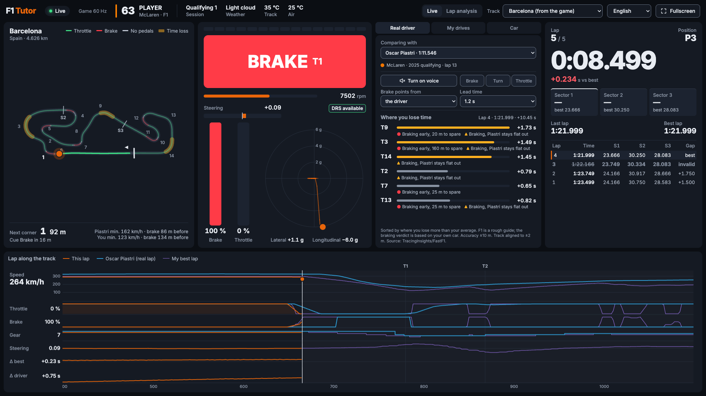
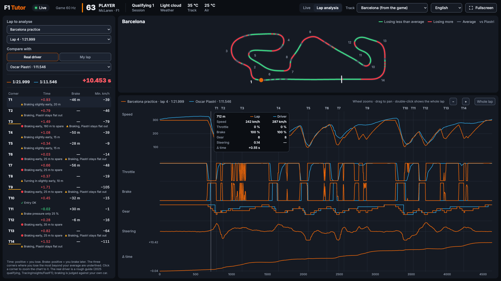
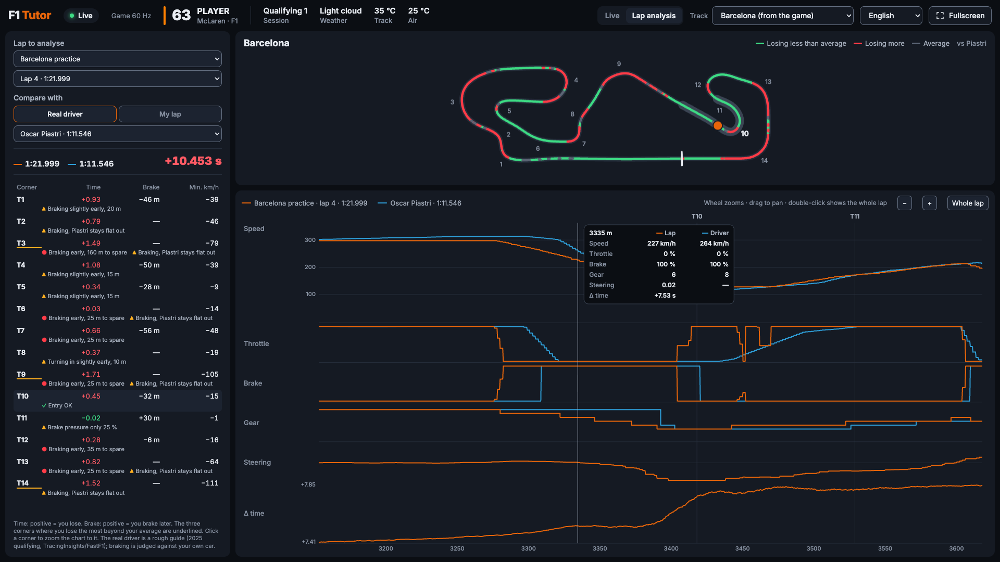
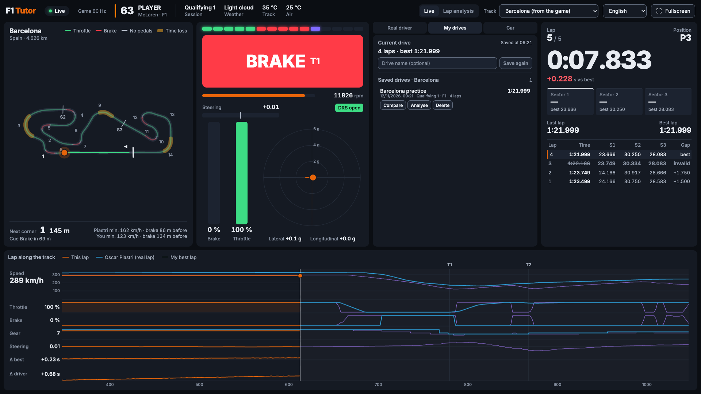
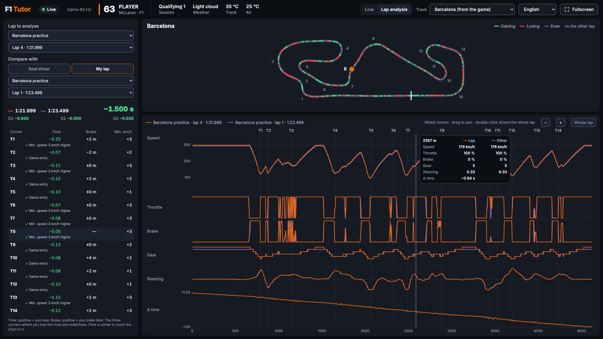
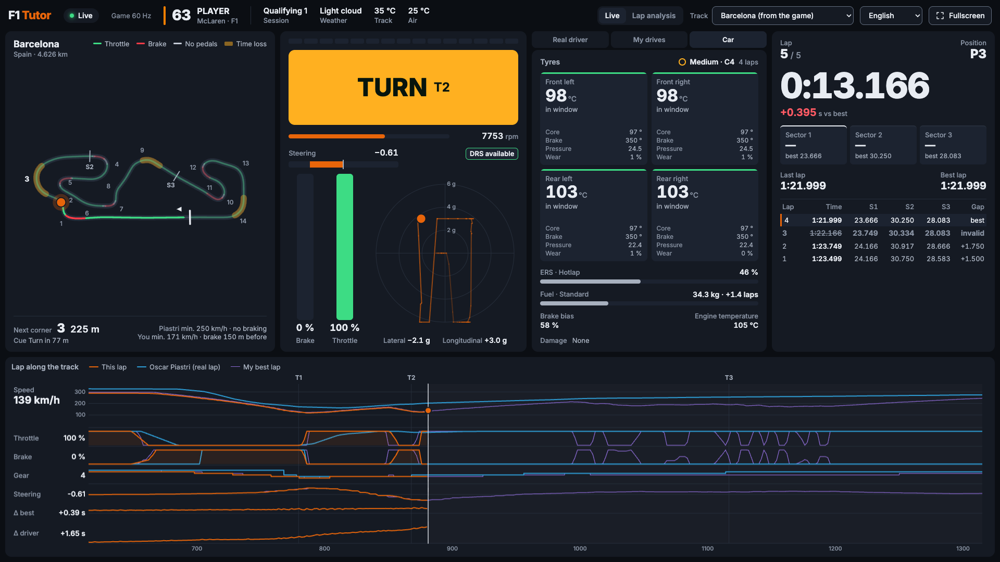
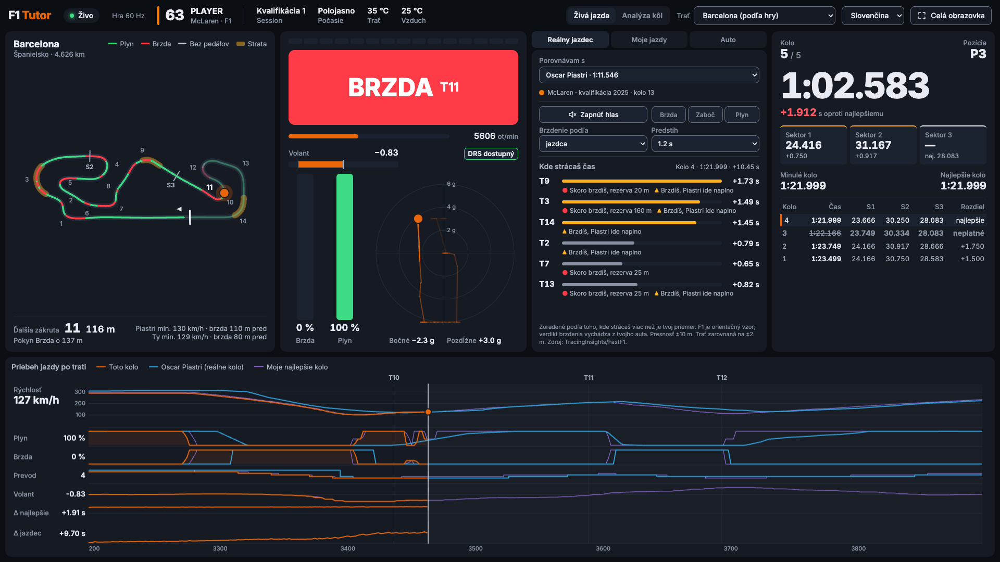
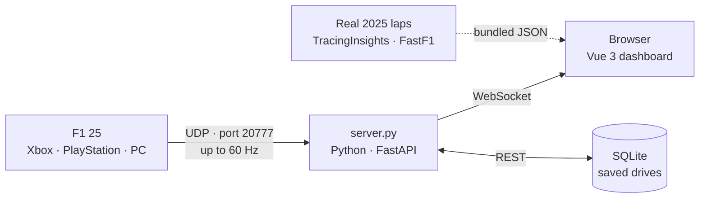

<div align="center">

# F1 Tutor

**Live telemetry and voice coaching for EA SPORTS™ F1® 25, compared corner by corner with real Formula 1 drivers.**

[](https://github.com/arno2303/f1-tutor/actions/workflows/tests.yml)
[](https://github.com/arno2303/f1-tutor/releases)
[](LICENSE)




</div>

F1 Tutor reads the telemetry that F1 25 sends over your home network and turns it into a fullscreen dashboard in the browser. It compares every lap with a real 2025 qualifying lap: **where you brake too early, where you lift while the real driver stays flat out, and where you turn in too soon**. Voice cues then tell you when to brake, turn and get back on the throttle. Laps can be saved and analysed later, even when the game isn't running.

It runs on your own computer. The game can run on Xbox, PlayStation or PC; it was developed with an Xbox on Wi-Fi.

## Contents

- [Features](#features)
- [Screenshots](#screenshots)
- [How it works](#how-it-works)
- [Quick start](#quick-start)
- [Using F1 Tutor](#using-f1-tutor)
- [Troubleshooting](#troubleshooting)
- [Development](#development)
- [Data sources and credits](#data-sources-and-credits)
- [License](#license)

## Features

- **Live dashboard at 60 Hz:** speed, gear, rpm, throttle, brake, steering, g-force, DRS, lap and sector times, the track map with your car on it, and a rolling chart of the lap against the real driver and your best lap.
- **Real F1 driver comparison:** 475 real qualifying laps from the 2025 season, one per driver, on all 24 circuits in the game. Pick any driver; the fastest is the default.
- **Corner-by-corner coaching:** corners are ranked by where you lose more than your lap's average, with verdicts such as *Braking early, 25 m to spare*, *Braking, Piastri stays flat out* or *Turning in slightly early, 10 m*.
- **Braking judged on your own car:** a real F1 car brakes far later than an F2 car or a game setup with assists, so "too early" is measured against the deceleration your car showed on your own laps, not against the real driver.
- **Voice cues:** *Brake*, *Turn* and *Throttle*, spoken a set time before each point (0.8 to 2.0 s, default 1.2 s). The browser's speech voice reads them in the app's language, or you can [record your own](voice/README.md).
- **Save drives to SQLite:** lap times plus the full telemetry of every lap. Saving the same session again adds the new laps.
- **Lap analysis:** compare any saved lap with a real driver or with any of your own laps at the same track. Includes a zoomable chart with speed, throttle, brake, gear, steering and time gap, a map coloured by time gained and lost, and a corner table with brake points, minimum speeds and turn-in.
- **Works without the game:** saved drives and analysis are always available. A simulator sends realistic fake data for trying the app.
- **Connection diagnostics:** the top bar shows the data rate really arriving and which link stalled, because Wi-Fi drops are the most common cause of a frozen dashboard.
- **English and Slovak:** the language is chosen in the top bar and remembered.
- **Private by default:** the server only answers this computer, and other websites in the same browser can't read your telemetry or change saved drives.

## Screenshots

<table>
  <tr>
    <td width="50%"><a href="docs/screenshots/analysis-vs-real-driver.png"></a><br><sub><b>Lap analysis vs a real driver.</b> Each corner's time, brake point, minimum speed and verdict; the map shows where you lose more than average.</sub></td>
    <td width="50%"><a href="docs/screenshots/analysis-corner-zoom.png"></a><br><sub><b>Zoom to a corner.</b> Click a corner or use the mouse wheel; the tooltip compares both laps at that metre of the track.</sub></td>
  </tr>
  <tr>
    <td width="50%"><a href="docs/screenshots/my-drives.png"></a><br><sub><b>My drives.</b> Save the current drive, compare with a saved lap live, or open it in the analysis.</sub></td>
    <td width="50%"><a href="docs/screenshots/analysis-vs-own-lap.png"></a><br><sub><b>Your lap vs your lap.</b> Any two laps from any drives at the same track.</sub></td>
  </tr>
  <tr>
    <td width="50%"><a href="docs/screenshots/car-status.png"></a><br><sub><b>Car.</b> Tyre temperatures, pressures and wear, ERS, fuel, brake bias and damage.</sub></td>
    <td width="50%"><a href="docs/screenshots/slovak.png"></a><br><sub><b>Slovak.</b> Every text, including the coaching verdicts and voice cues.</sub></td>
  </tr>
</table>

<sub>Screenshots were made with the built-in simulator, so the laps are synthetic.</sub>

## How it works



1. **Decoding.** `f1_udp.py` decodes the F1 25 UDP format (packet format 2025): motion, session, lap data, participants, car telemetry, car status and car damage. Every packet size is checked against the official specification.
2. **Streaming.** `server.py` keeps the player car's latest state and sends only what changed to the browser over a WebSocket.
3. **Recording.** The browser records each lap on a 2 m grid along the track. Short gaps from Wi-Fi drops are interpolated, and flashbacks rewind the lap.
4. **Aligning with the real lap.** The game's track coordinates are fitted onto the real lap's with a rotation and shift, refined point by point (ICP), typically to within 3 to 5 m. This maps the game's lap distance onto the real lap's, so every metre of your lap meets the same place on the real one. The fit is remembered per track and driver.
5. **Coaching.** For each corner the app finds the brake point, throttle lift, turn-in, minimum speed, brake pressure and coasting for both laps. Your braking is compared with a braking curve fitted to your own laps, which gives the metres you had to spare. The thresholds come from a method first verified on a real lap at Barcelona.
6. **Cues.** The next brake, turn-in and throttle points are announced a set time ahead at your current speed, with braking taking priority.

The real laps are a rough guide: they're sampled about every 20 m at full speed, so positions are accurate to about ±10 m.

## Quick start

You need [Python](https://www.python.org/downloads/) 3.11 or newer and [Node.js](https://nodejs.org/) 22.

```bash
git clone https://github.com/arno2303/f1-tutor.git
cd f1-tutor
python3 -m venv .venv
.venv/bin/pip install -r requirements.txt
cd frontend && npm install && npm run build && cd ..
.venv/bin/python server.py
```

On Windows use `.venv\Scripts\pip` and `.venv\Scripts\python` instead.

The browser opens by itself, and the terminal prints the address to enter in the game. In F1 25 open **Game Options → Settings → Telemetry Settings** and set:

| Setting | Value |
|---|---|
| UDP Telemetry | On |
| UDP Broadcast Mode | Off |
| UDP IP Address | the IP printed by `server.py` |
| UDP Port | 20777 |
| UDP Send Rate | 60 Hz |
| UDP Format | 2025 |

The computer and the console must be on the same network. Drive out of the garage and the dashboard comes alive.

**No game at hand?** Start the simulator in a second terminal:

```bash
python3 tools/simulate_game.py --track 4 --time-scale 5    # Barcelona, five times faster
```

### Options

| Option | Default | |
|---|---|---|
| `--udp-port` | 20777 | port the game sends to |
| `--port` | 8000 | port of the web app |
| `--host` | 127.0.0.1 | `0.0.0.0` lets a tablet on your network open the app at this computer's IP |
| `--hz` | 60 | most updates per second sent to the browser; more than the game's send rate doesn't help |
| `--db` | `data/f1tutor.db` | file for saved drives |
| `--no-browser` | | don't open the browser |

## Using F1 Tutor

Press **F** for fullscreen. **Live** and **Lap analysis** switch views, and the track menu follows the game unless you pick a track yourself.

### Real driver

The **Real driver** tab compares your last lap with the chosen driver's 2025 qualifying lap. *Where you lose time* lists the corners where you lose more than your lap's average, with a verdict for each. The first lap at a track also fits the game's coordinates to the real lap; until then, positions can be tens of metres out.

Click **Turn on voice** once each time the page is opened, because browsers block sound until you click. **Lead time** sets how early cues come. **Brake points from** chooses between the driver's real brake points and points your own car can make, based on your laps; F2 cars start on the latter.

### My drives

**Save drive** stores the current session's laps and telemetry, with an optional name. **Compare** makes a saved lap the purple line in the live chart and shows the gap in total, per sector and per corner. **Analyse** opens the drive in the lap analysis. Laps not yet saved live only in the browser, so a reload loses them; if a new session starts first, the tab offers to save the previous one.

### Lap analysis

Pick any saved lap, or a lap of the current drive, and compare it with a **Real driver** or **My lap** at the same track. The mouse wheel zooms, dragging pans, a double click shows the whole lap, and clicking a corner in the table zooms to it. Against a real driver, who is faster almost everywhere, the map shows where you lose more or less than your lap's average.

## Troubleshooting

| Problem | What to check |
|---|---|
| The dashboard says *Waiting for the game* | The IP and port in the game match what `server.py` printed, both devices are on the same network, and the firewall allows Python to receive on UDP 20777. `python3 f1_udp.py` prints raw packets to test the connection; only one program can listen on the port at a time. |
| The data jumps or freezes | Usually Wi-Fi. The top bar shows the real rate and names the link that stalled. A network cable for the console or the computer helps most. |
| Positions on the map are off | Drive one full lap so the track can be aligned. |
| No voice | Click **Turn on voice** after each page load. Without your own recordings, your system needs a speech voice for the app's language. |
| A browser tab shows old behaviour after an update | It reloads itself when it notices a new build. If not, reload it once. |

## Development

```bash
.venv/bin/pip install -r requirements-dev.txt
.venv/bin/python -m unittest discover -s tests   # backend: decoder, server, database, security
cd frontend && npm test                          # frontend: recording, alignment, coaching, cues, i18n
cd frontend && npm run dev                       # hot reload; needs server.py running
```

The backend tests decode real F1 25 packet captures (`tests/data`). The frontend tests check lap recording, alignment, the coaching rules and the cue timing.

```
f1_udp.py               F1 25 UDP decoder; run it to print live data
server.py               UDP listener, WebSocket feed, REST API for saved drives
results_db.py           SQLite storage
frontend/src/telemetry  lap recording, alignment, coaching, cues, analysis
frontend/src/components dashboard, coach, drives and analysis views
frontend/src/i18n       English and Slovak texts
tools/                  simulator and the scripts that build the track and real-lap data
packaging/              optional Windows program (PyInstaller)
```

- **Translations:** all texts are in `frontend/src/i18n/en.ts` and `sk.ts`. A test fails if a key is missing or a placeholder differs. A new language is one more file of the same shape plus an entry in `i18n/index.ts`.
- **Data:** `python3 tools/build_tracks.py` rebuilds the maps in `frontend/src/data/tracks.json`, and `python3 tools/build_reference.py` rebuilds the real laps in `frontend/public/reference/`.
- **Windows program:** `packaging/f1tutor.spec` builds a single `F1Tutor.exe` that needs no Python or Node. Run the **Windows exe** workflow under Actions to build and smoke-test it on a real Windows machine. `packaging/GUIDE.txt` is the guide for the first start.

## Data sources and credits

- **Real driver laps, track outlines and corner positions:** [TracingInsights/2025](https://github.com/TracingInsights/2025), an archive of 2025 Formula 1 telemetry (Apache-2.0).
- **[FastF1](https://github.com/theOehrly/Fast-F1):** the Python library that the archive's data is exported with (MIT).
- **UDP packet captures for tests:** [mini-sector/f1-packets](https://github.com/mini-sector/f1-packets) (MIT).
- **Packet format:** the official [EA SPORTS F1 25 UDP specification](https://forums.ea.com/blog/f1-games-game-info-hub-en/ea-sports%E2%84%A2-f1%C2%AE25-2026-season-pack-udp-specification/12187347).
- Built with [FastAPI](https://github.com/fastapi/fastapi), [Uvicorn](https://github.com/encode/uvicorn), [Vue](https://github.com/vuejs/core), [Vite](https://github.com/vitejs/vite) and the [Inter](https://github.com/rsms/inter) typeface.

See [NOTICE](NOTICE) for the licences of included data.

## License

[MIT](LICENSE) © 2026 Lukas Vavro.

F1 Tutor is an unofficial fan project. It isn't associated with Formula 1, the FIA, Electronic Arts or Codemasters. F1, FORMULA 1 and related marks are trademarks of Formula One Licensing B.V. EA SPORTS F1 25 is a trademark of Electronic Arts Inc.
